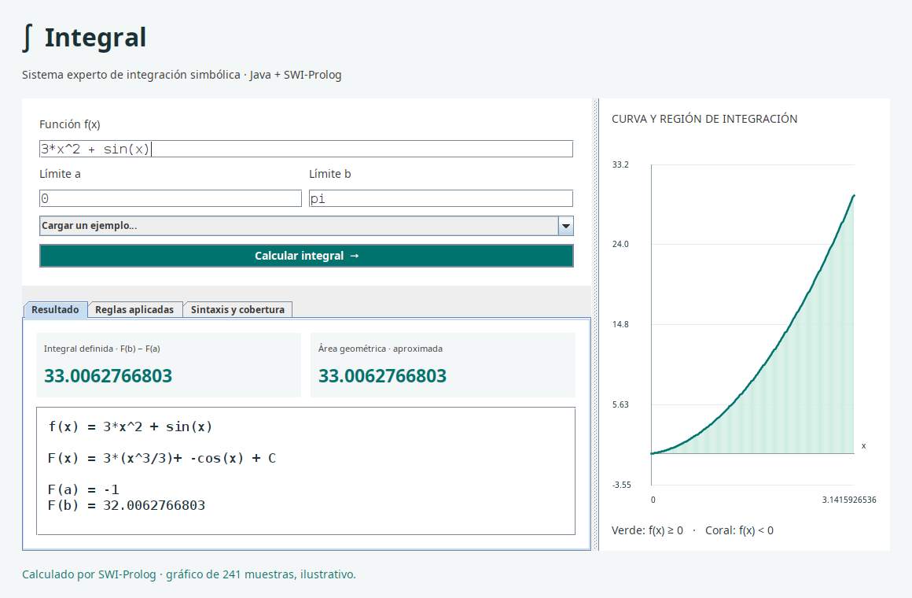

# ∫ Integral — Proyecto Final de Programación Declarativa

**Ciclo 02/2026.** Sistema experto de integración simbólica con interfaz **Java Swing** y base de conocimiento exclusivamente en **SWI-Prolog**.

Obtiene una antiderivada, evalúa `F(b) − F(a)`, aproxima el área geométrica y muestra las reglas utilizadas y la curva. No utiliza SymPy, servicios externos ni un motor matemático en Java.



## Ejecutar

Requisitos: **JDK 17 o posterior**, SWI-Prolog y un entorno gráfico de escritorio.

Desde la raíz del proyecto:

```sh
sh scripts/ejecutar.sh
```

No necesita Maven, Gradle ni descargar bibliotecas Java. Los `.class` se generan en `build/`.

En este equipo SWI-Prolog está instalado como Flatpak (`org.swi_prolog.swipl`); tanto el puente Java como los scripts lo detectan automáticamente si `swipl` no está en el `PATH`. Flatpak debe tener acceso a la carpeta del proyecto. En un entorno aislado que impida ejecutar Flatpak, ejecutar desde una terminal normal del escritorio.

Con una instalación nativa fuera del `PATH`, Java permite:

```sh
SWIPL_EXECUTABLE=/ruta/a/swipl sh scripts/ejecutar.sh
```

Alternativa manual, también útil en Windows con `swipl.exe` configurado en `SWIPL_EXECUTABLE`:

```sh
javac -encoding UTF-8 -d build java/*.java
java -cp build Aplicacion
```

La carpeta de trabajo debe ser la raíz del proyecto. Los scripts `.sh` requieren un shell POSIX.

## Uso

1. Introducir una expresión de **x minúscula**, sin punto final.
2. Introducir los límites `a` y `b`; se admiten `pi`, `e` y expresiones constantes como `pi/2`.
3. Pulsar **Calcular integral** o Enter.
4. Consultar **Resultado**, **Reglas aplicadas** y **Sintaxis y cobertura**.

Usar `*` para multiplicar, `^` para potencias, punto decimal y ángulos en **radianes**. `asin` y `acos` significan funciones inversas, no recíprocos.

| Expresión | a | b | Integral definida | Área geométrica |
|---|---:|---:|---:|---:|
| `5` | 0 | 2 | 10 | 10 |
| `x^2` | 3 | 5 | 32.6666666667 | 32.6666666667 |
| `x` | -1 | 1 | 0 | 1 |
| `x^2` | 2 | 0 | -2.6666666667 | 2.6666666667 |
| `x^(-1)` | 1 | e | 1 | 1 |
| `sin(x)` | 0 | pi | 2 | 2 |
| `2^(3*x+1)` | 0 | 1 | 6.7325768575 | 6.7325768575 |

`1/x` entre -1 y 1 **se rechaza**: no se devuelve cero por evaluar mecánicamente una primitiva a ambos lados de una singularidad.

## Cobertura del enunciado

Se incluyen reglas para las familias de los 22 incisos, con el alcance explícito siguiente. Se supera el mínimo de doce sin contar las composiciones generales como integrables universalmente.

| Inciso | Familia | Ejemplo aceptado |
|---|---|---|
| a | Constante numérica | `7` |
| b | Variable | `x` |
| c | Constante por variable | `3*x` |
| d | Potencia entera, incluido n = -1 | `x^5`, `x^(-1)` |
| e | Función u resoluble por las reglas disponibles | `sin(2*x+1)` |
| f | Constante por función admitida | `4*cos(x)` |
| g | Suma recursiva | `x^2+sin(x)` |
| h | Resta recursiva | `x^3-cos(x)` |
| i | Exponencial de base positiva | `2^x` |
| j | Exponencial con exponente afín | `2^(3*x+1)` |
| k | Seno | `sin(x)` |
| l | Coseno | `cos(x)` |
| m | Tangente | `tan(x)` |
| n | Arcoseno | `asin(x)` |
| o | Arcocoseno | `acos(x)` |
| p | Arcotangente | `atan(x)` |
| q | Seno hiperbólico | `sh(x)` o `sinh(x)` |
| r | Coseno hiperbólico | `cosh(x)` |
| s | Tangente hiperbólica | `tanh(x)` |
| t | Arcoseno hiperbólico | `arcsinh(x)` o `asinh(x)` |
| u | Arcocoseno hiperbólico | `arccosh(x)` o `acosh(x)` |
| v | Arcotangente hiperbólica | `arctanh(x)` o `atanh(x)` |

También se admiten `exp(x)`, `log(x)`/`ln(x)`, división por constantes y recíprocos afines. Las funciones de una variable, potencias enteras y exponenciales pueden usar un argumento **afín** `m*x+c`, con `m != 0`; por ejemplo, `cos(3*x-2)` y `(2*x+1)^4`.

### Límites explícitos

- No es un integrador universal: se rechazan `sin(x^2)`, `x*sin(x)`, productos generales, sustituciones no afines e integrales sin una regla conocida.
- Solo intervalos reales donde la función es continua. No se admiten integrales impropias, complejas o valores principales de Cauchy.
- Se valida todo el intervalo, no solo los extremos: ceros del denominador, polos de tangente y dominios de inversas/logaritmos.
- `asin`/`acos`: argumentos entre -1 y 1, inclusive; `acosh`: desde 1; `atanh`: estrictamente entre -1 y 1; `log`: positivo.
- Límites con valor absoluto máximo `1e6`, literales/constantes normalizadas de hasta `1e12`, exponentes numéricos de hasta 1000 en valor absoluto, profundidad sintáctica máxima 60 y entrada de hasta 2000 caracteres. El cálculo puede rechazarse antes por desbordamiento numérico.
- Tiempo de cálculo Prolog máximo 12 s; espera Java máxima 18 s. Se rechazan áreas que no convergen con los recursos disponibles.
- El área se aproxima con Simpson adaptativo sobre `abs(f(x))`, tolerancia absoluta **objetivo** `1e-7`, profundidad 32 y entre 32 y 4096 subintervalos iniciales. La frecuencia de los senos/cosenos/tangentes afines determina un mínimo de subdivisiones para reducir aliasing. El estimador no constituye una garantía formal de error para toda función admitida, especialmente cancelaciones severas o valores extremos.
- La gráfica usa 241 muestras; es ilustrativa y puede omitir oscilaciones o detalles entre muestras. **No se calcula el área con los píxeles ni con estas muestras.**

## Relación con los PDF de clase

- **Clase 11:** diferencia entre construir términos mediante unificación y evaluarlos con `is/2`.
- **Clase 12:** `s(Variable, Expresion, Resultado)`, casos base y recursión para la linealidad.
- **Clase 13:** una variable Prolog libre permite evaluar la primitiva en distintos valores. En vez de `asserta`/`abolish`, se usa `copy_term/2` para cada evaluación: evita estado global y conserva la variable original sin ligar.

Los PDF y el ejercicio original se utilizaron únicamente como referencia y no forman parte del repositorio. La implementación se encuentra en `prolog/integrales.pl`.

Consulta interactiva:

```sh
sh scripts/swipl.sh -q -s prolog/integrales.pl
```

```prolog
?- s(x, x^2, F).
F = x^3/3.

?- s(X, X^2, F), evaluar(X,F,5,FB), evaluar(X,F,3,FA), Area is FB-FA.
% X permanece libre; Area = 32.666666666666664 aproximadamente.

?- analizar("x", -1, 1, R), D = R.definida, A = R.area.
% D = 0.0, A = 1.0.
```

En `s/3`, `F` omite la constante de integración; la interfaz agrega `+ C`. La presentación simbólica se simplifica localmente, no se reduce a una forma algebraica canónica.

Referencia técnica: [aritmética oficial de SWI-Prolog](https://www.swi-prolog.org/man/arith.html), para `is/2` y funciones trigonométricas/hiperbólicas.

## Pruebas

```sh
sh scripts/probar.sh
```

Incluye PLUnit (reglas, derivación numérica de las primitivas de las 22 familias, ejemplo de clase 13, dominios, área, orientación y entradas maliciosas) y una prueba Java–Prolog real sin abrir la ventana. Compila Java con `-Xlint:all`.

Verificado en este equipo con OpenJDK 17 y SWI-Prolog 10.1.18: **82 instancias PLUnit**, **12 comprobaciones Java–Prolog** y la prueba visual opcional.

Prueba visual opcional (abre y cierra la ventana, comprueba cálculo/error y guarda `docs/captura.png`):

```sh
javac -encoding UTF-8 -d build java/*.java tests/PruebaInterfaz.java
java -cp build PruebaInterfaz
```

## Estructura

```text
prolog/integrales.pl           Reglas simbólicas, validación, evaluación y área
prolog/puente.pl               Entrada/salida del proceso Prolog
java/Aplicacion.java           Interfaz Swing y dibujo de muestras
java/PuenteProlog.java         Transporte y lectura de resultados, sin cálculo simbólico
tests/integrales_tests.pl      Pruebas PLUnit
tests/PruebaPuente.java        Prueba de integración Java–Prolog
tests/PruebaInterfaz.java      Prueba visual opcional sobre el escritorio
scripts/ejecutar.sh            Compilar y abrir interfaz
scripts/probar.sh              Ejecutar todas las pruebas
scripts/swipl.sh               Detectar SWI-Prolog nativo o Flatpak
docs/defensa.md                Arquitectura, decisiones y demostración sugerida
```

Entrega indicada en el enunciado: **lunes 16 de noviembre de 2026**, Moodle del DEI; grupos de cuatro. Los datos de integrantes, informe y presentación final deben completarse con el equipo; no se inventaron nombres ni carnés.
